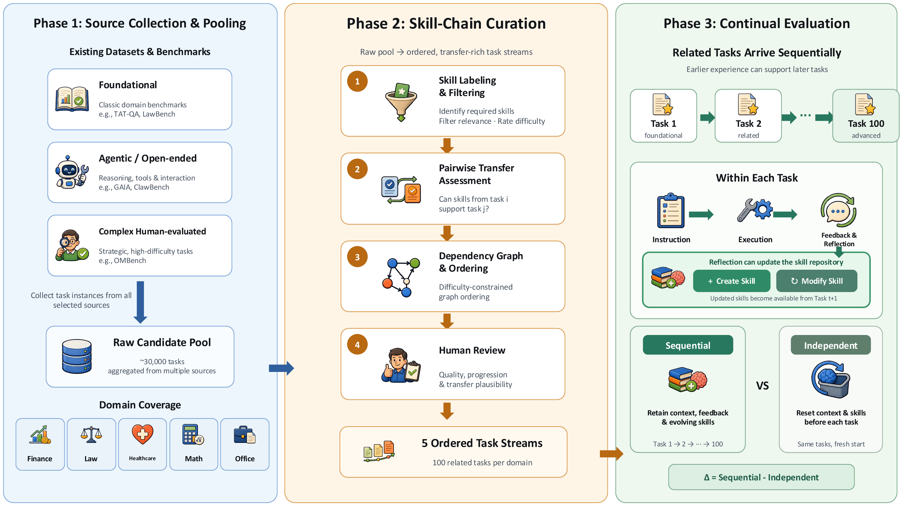

<div align="center">

# ContinualSkillBench

### Can LLM Agents Truly Evolve Their Capabilities?

[](https://arxiv.org/abs/2608.03874)
[](paper/preprint.pdf)
[](LICENSE)
[](https://www.python.org/)

**A benchmark for evaluating whether LLM agents can accumulate, retain, and reuse skills across long task sequences.**

[[Paper](https://arxiv.org/abs/2608.03874)] · [[Local PDF](paper/preprint.pdf)] · [[Benchmark Documentation](Continual-Skill-Bench/README.md)]

</div>



## Overview

Most agent benchmarks evaluate tasks independently and reset the agent after every episode. **ContinualSkillBench** instead presents agents with ordered streams of related tasks, allowing experience, evaluator feedback, and maintained skills to influence later behavior.

The benchmark contains **500 tasks** organized into five domain-specific streams of 100 tasks each. Its dependency-aware ordering creates opportunities for forward transfer while retaining diverse task formats and evaluation methods.

| Domain | Examples of evaluated capabilities |
| --- | --- |
| Finance | Financial analysis, tabular reasoning, and quantitative calculation |
| Law | Legal reasoning, evidence synthesis, and structured analysis |
| Healthcare | Clinical reasoning, information extraction, and decision support |
| Mathematics | Symbolic, numerical, and programmatic problem solving |
| Office | Document, spreadsheet, and productivity workflows |

ContinualSkillBench is designed around three questions:

1. Does sequential interaction improve downstream task performance?
2. Do explicit skill repositories provide benefits beyond retained context and feedback?
3. Can agents consolidate experience into reusable skills, or do their skill libraries become fragmented and task-specific?

## Highlights

- **Long-horizon evaluation:** 100 related tasks per domain, rather than isolated episodes.
- **Dependency-aware task streams:** tasks are labeled, filtered, and ordered to create meaningful opportunities for skill transfer.
- **Multiple execution settings:** compare Independent, pure ICL, and skill-maintaining Sequential execution.
- **Heterogeneous evaluation:** Exact Match, F1, Numeric, Programmatic, and rubric-based evaluators.
- **Reproducible agent harness:** sandboxed execution, job orchestration, verification, and trajectory logging through Harbor.
- **Inspectable trajectories:** generated skills, model interactions, evaluator feedback, and per-task rewards are retained for analysis.

## Repository Structure

```text
.
├── Continual-Skill-Bench/
│   ├── tasks/                  # Sequential and independent benchmark tasks
│   ├── experiments/configs/    # Example experiment configurations
│   ├── pipeline/               # Task filtering, dependency analysis, and ordering
│   ├── scripts/                # Data preparation and analysis utilities
│   └── docs/                   # Additional benchmark documentation
├── figure/                     # Paper and README figures
├── paper/                      # Paper PDF
├── src/harbor/                 # Harbor-based evaluation harness
├── pyproject.toml
└── README.md
```

## Installation

### Requirements

- Python 3.12 or later
- Docker installed and running
- API credentials for the model provider being evaluated

Clone the repository and install the included Harbor harness:

```bash
git clone https://github.com/gtynnn060110-hash/continual-skill-bench-final.git
cd continual-skill-bench-final

python -m venv .venv
source .venv/bin/activate
pip install -e .
```

Verify the installation:

```bash
harbor --help
harbor jobs start --help
```

Set the credentials required by your selected agent and model, for example:

```bash
export OPENAI_API_KEY="..."
export ANTHROPIC_API_KEY="..."
```

## Evaluation Settings

| Setting | Context and feedback | Skill repository |
| --- | --- | --- |
| **Independent (Ind.)** | Reset before every task | Reset before every task |
| **Pure ICL** | Retained across the ordered stream | Available skills are fixed; the agent cannot maintain or update the repository |
| **Sequential (Seq.)** | Retained across the ordered stream | The agent can create, modify, and reuse skills |

The repository includes the agents used in our experiments, including `codex`, `codex-seq`, `codex-seq-icl`, `claude-code`, `claude-code-seq`, and `claude-code-rag`.

## Running the Benchmark

### Sequential execution

Run a complete 100-task stream directly from the repository root:

```bash
harbor jobs start \
  --path Continual-Skill-Bench/tasks/finance-econ-100 \
  --agent codex-seq \
  --model openai/gpt-4o \
  --job-name finance_seq_codex \
  --jobs-dir jobs
```

The five paper domains are available at:

| Domain | Sequential task path |
| --- | --- |
| Finance | `Continual-Skill-Bench/tasks/finance-econ-100` |
| Law | `Continual-Skill-Bench/tasks/law-100` |
| Healthcare | `Continual-Skill-Bench/tasks/healthcare-100` |
| Mathematics | `Continual-Skill-Bench/tasks/math-100` |
| Office | `Continual-Skill-Bench/tasks/office-100` |

### Independent execution

Independent-trial directories reset the interaction state for each subtask:

```bash
harbor jobs start \
  --path Continual-Skill-Bench/tasks/finance-econ-100-independent-trials \
  --agent codex \
  --model openai/gpt-4o \
  --job-name finance_ind_codex \
  --jobs-dir jobs \
  --n-concurrent 4
```

Equivalent independent-trial directories are included for Law, Healthcare, Mathematics, and Office.

### Configuration files

Reusable Harbor configurations are located in `Continual-Skill-Bench/experiments/configs/`. For example:

```bash
harbor jobs start \
  -c Continual-Skill-Bench/experiments/configs/finance_econ_100_independent_trials.yaml
```

If a configuration uses relative task paths such as `./tasks/...`, run it from `Continual-Skill-Bench/` or update the path for your working directory.

## Outputs

A typical trial directory records the final result, agent trajectory, generated skills, and verifier output:

```text
jobs/<job_name>/<trial_name>/
├── result.json
├── agent/
│   ├── command-*/stdout.txt
│   ├── trajectory.json
│   └── skills-verified.txt
└── verifier/
    ├── reward.txt
    └── ctrf.json
```

These artifacts support task-level error analysis as well as longitudinal analyses of skill creation, modification, reuse, and fragmentation.

## Citation

If you find ContinualSkillBench useful, please cite our paper:

```bibtex
@misc{guan2026continualskillbenchllmagentstruly,
      title={ContinualSkillBench: Can LLM Agents Truly Evolve Their Capabilities?},
      author={Tianyi Guan and Yiding Wang and Haotong Yang and Siyuan Cao and Shirui Liu and Yi Hu and Jiaqi Li and Muhan Zhang},
      year={2026},
      eprint={2608.03874},
      archivePrefix={arXiv},
      primaryClass={cs.AI},
      url={https://arxiv.org/abs/2608.03874}
}
```

## License

The repository code is released under the [Apache License 2.0](LICENSE). Tasks derived from external datasets remain subject to their original licenses and terms of use.

